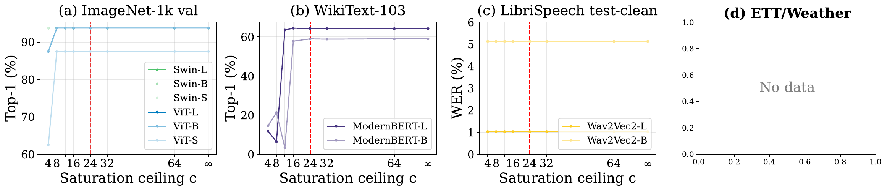

# LightMax

LightMax is a hardware-efficient softmax approximation based on lookup tables
for the exponential and the log-sum. This project evaluates it — together with
plain pre-softmax saturation — on four domains: image classification, language
modelling, speech recognition and time-series forecasting.

## Usage

Two entry-point scripts run all four tasks:

```bash
# Saturation sweep on all tasks, baseline included, saturations 4..64
# (baseline + plain clamp hooks, no LightMax):
./run_all_saturations.sh [--dry-run] [--num-samples N]

# LightMax on all tasks: c = 24, in/out bit-width = 8, k = 4, s = 6
./run_lightmax.sh [--dry-run]
```

Both write one CSV per task into `panda/`. Individual eval scripts
(`eval_image.py`, `eval_language.py`, `eval_speech.py`, `eval_time_series.py`)
can also be called directly for custom configurations (`--help` for options);
`python lightmax.py` runs a standalone LightMax accuracy benchmark.

## Pretrained models

All listed models are expected and never retrained here — except PatchTST,
which is fine-tuned (recipe below). Weights are downloaded automatically on
first use (HF hub cache configured in `utils/dataset_config.py`).

| Task | Model | Architecture | Download |
|---|---|---|---|
| Image | ViT-S/B/L (`vit_{small,base,large}_patch16_224`) | ViT patch-16 @ 224²; S: d=192, 12 layers · B: d=768, 12 layers · L: d=1024, 24 layers; ImageNet-1k fine-tuned | [timm on HF hub](https://huggingface.co/timm), e.g. [vit_small_patch16_224.augreg_in21k_ft_in1k](https://huggingface.co/timm/vit_small_patch16_224.augreg_in21k_ft_in1k) |
| Image | Swin-S/B/L (`swin_{small,base,large}_patch4_window7_224`) | Swin Transformer, patch 4, window 7², 2 stages; S: C=48 · B: C=88 · L: C=96 | [timm on HF hub](https://huggingface.co/timm), e.g. [swin_small_patch4_window7_224.ms_in1k](https://huggingface.co/timm/swin_small_patch4_window7_224.ms_in1k) |
| Language | ModernBERT-B/L (`answerdotai/ModernBERT-{base,large}`) | ModernBERT MLM: base 149 M (d=768, 22 layers, 8k ctx) · large 396 M (d=1024, 28 layers), 28k BPE vocab, alternating global/local attention | [answerdotai/ModernBERT-base](https://huggingface.co/answerdotai/ModernBERT-base), [answerdotai/ModernBERT-large](https://huggingface.co/answerdotai/ModernBERT-large) |
| Speech | wav2vec2-B/L (`facebook/wav2vec2-{base,large}-960h`) | wav2vec2 transformer + quantisation objectives, CTC, LibriSpeech-960h fine-tuned: B: d=768, 12 layers · L: d=1024, 24 layers | [facebook/wav2vec2-base-960h](https://huggingface.co/facebook/wav2vec2-base-960h), [facebook/wav2vec2-large-960h](https://huggingface.co/facebook/wav2vec2-large-960h) |
| Time series | PatchTST (`ibm-research/patchtst-etth1-pretrain`) | PatchTST: channel-independent encoder, patch length 12 / stride 12, d=128, 6 layers, 16 heads, FFN 512 | [ibm-research/patchtst-etth1-pretrain](https://huggingface.co/ibm-research/patchtst-etth1-pretrain) (transformers ≥5.x loading handled by `utils/patchtst_utils.py`) |

PatchTST is the only **fine-tuned** model. Recipe (full model, all
parameters): 80/20 chronological split, per-channel z-score with train-split
statistics, sliding windows seq 512 → horizon 96 (train stride 8),
Adam lr 1e-4 with cosine annealing to 1e-6, 50 epochs, batch 64, MSE,
fp16 AMP, checkpointer keeps the best-by-test-MSE epoch to
`models/<DATASET>/model.pt` (matching the `--out-dir models/` default of
`finetune/finetune_patchtst.py`, which `eval_time_series.py` reads via its
`--finetune-dir` default). Run:

```bash
python finetune/finetune_patchtst.py            # defaults match the recipe above
```

## Datasets

| Task | Dataset | Metric | Location / download |
|---|---|---|---|
| Image | ImageNet-1k validation | top-1 / top-5 | `/media/lubin/Datasets/Imagenet/val` (`--dataset`). Manual download from [image-net.org](https://image-net.org): one subdirectory per class (`.jpg/.jpeg/.png`); class indices are assigned by sorting directory names, so name them in class-index order (e.g. `0000`…`0999`) |
| Language | WikiText-103 (raw) test | CE, PPL, Top-1, KL | automatic HF download: `Salesforce/wikitext`, `wikitext-103-raw-v1`, split `test` ([dataset card](https://huggingface.co/datasets/Salesforce/wikitext)) |
| Speech | LibriSpeech test-clean | WER | automatic HF download: `openslr/librispeech_asr`, config `clean`, split `test` ([dataset card](https://huggingface.co/datasets/openslr/librispeech_asr); original: [OPENSLR SLR12](https://www.openslr.org/12)) |
| Time series | ETT (ETTh1/h2/m1/m2) + Weather | MAE, MSE | `/media/lubin/Datasets/Forecasting` (`--dataset`): flat `<name>.csv` files with a `date` column + numeric channels. ETT: [ETDataset](https://github.com/zhouhaoyi/ETDataset); Weather (Wuhan 2020–21, 21 channels): [Time-Series-Library data](https://github.com/thuml/Time-Series-Library) |

The forecasting CSVs must be named `ETTh1.csv`, `ETTh2.csv`, `ETTm1.csv`,
`ETTm2.csv`, `weather.csv`, each with a parseable `date` first column.

## Figures

Render the saturation figure (1×4 subplot of performance vs saturation, from
the CSVs in `panda/`):

```bash
python figures/plot_saturation.py --input-dir panda --output-dir figures
```

Render the baseline-vs-LightMax comparison table (LaTeX):

```bash
python figures/plot_lightmax.py --input-dir panda --output-dir figures
```

### Performance vs saturation



### LightMax comparison (c = 24, in/out bit-width = 8, k = 4, s = 6)

| Task | Model | Baseline | LightMax | Diff |
|---|---|---:|---:|---:|
| Image | Swin-B | 85.13 | 84.95 | ↓ 0.18 |
| Image | Swin-L | 86.25 | 86.14 | ↓ 0.11 |
| Image | Swin-S | 83.25 | 83.18 | ↓ 0.07 |
| Image | ViT-B | 80.99 | 80.70 | ↓ 0.29 |
| Image | ViT-L | 84.32 | 84.14 | ↓ 0.18 |
| Image | ViT-S | 74.19 | 73.84 | ↓ 0.35 |
| Time series | PatchTST-ETTh1 | 1.0192 | 1.0262 | ↑ 0.0071 |
| Time series | PatchTST-ETTh2 | 0.1571 | 0.1598 | ↑ 0.0027 |
| Time series | PatchTST-ETTm1 | 0.3612 | 0.3670 | ↑ 0.0057 |
| Time series | PatchTST-ETTm2 | 0.1089 | 0.1179 | ↑ 0.0090 |
| Time series | PatchTST-Weather | 0.1501 | 0.1518 | ↑ 0.0018 |
| Language | ModernBERT-B | 63.19 | 62.59 | ↓ 0.60 |
| Language | ModernBERT-L | 68.40 | 67.71 | ↓ 0.69 |
| Speech | Wav2Vec2-B | 5.04 | 5.04 | — |
| Speech | Wav2Vec2-L | 4.23 | 4.23 | — |
