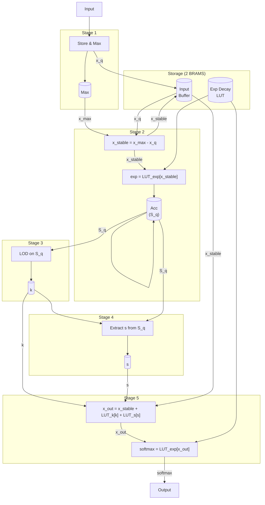

# III. Proposed LightMax

## A. Log-Domain Reformulation

We start from the stable softmax and take the natural logarithm:

$$\ln\bigl(\text{Softmax}(x_i)\bigr) = x_i^{\text{stable}} - \ln\!\left(\sum_{j=0}^{N-1} e^{x_j^{\text{stable}}}\right)$$

where $x_i^{\text{stable}} = x_i - x_{\max}$ and $x_{\max} = \max(x_0, \dots, x_{N-1})$.

We define the normalization sum $S = \sum_{j=0}^{N-1} e^{x_j^{\text{stable}}}$ and represent it in normalized floating-point form:

$$S = 2^k \cdot (1 + s)$$

where $k$ is a signed integer and $s \in [0, 1)$. Then:

$$\ln(S) = k \cdot \ln(2) + \ln(1 + s)$$. The log-domain output becomes:

$$x_i^{\text{out}} = x_i^{\text{stable}} - (k \cdot \ln(2) + \ln(1 + s))$$. The final softmax output is recovered by:

$$\text{Softmax}(x_i) = e^{x_i^{\text{out}}}$$. Exponential is pre-computed and stored in a LUT with $e^{x} = \text{LUT}_{\text{exp}}(x)$ , same for both $k \cdot \ln(2)$ and $\ln(1+s)$ with : $k \cdot \ln(2) = \text{LUT}_{k \cdot \ln(2)}(k)$ and $\ln(1+s) = \text{LUT}_{\ln(1+s)}(s)$. The final softmax output is computed using the same exponentiation LUT than the input. The entire datapath requires **no multipliers and no dividers**, only additions, subtractions, and LUT reads.

## B. Design Choices and Precision

**Saving addition and substraction** Since $x_i^{\text{stable}} \leq 0$, we redefine the index as $x_i^{\text{stable pos}} = x_{\max} - x_i = -x_i^{\text{stable}} \geq 0$ to keep all operands non-negative, that can directly drive the exponential LUT addresses: $$e^{x_i^{\text{stable}}} = e^{-(-x_i^{\text{stable}})} = e^{-x_i^{\text{stable pos}}} = \text{LUT}_{\text{exp decay}}(x_i^{\text{stable pos}})$$ with $x_i^{\text{stable pos}} \geq 0$ and $\text{LUT}_{\text{exp decay}}(x_i^{\text{stable pos}})$ is representing decaying exponential $e^{-x}$. We thus reformulate $x_i^{out}$ :$$x_i^{\text{out}} = - x_i^{\text{stable pos}} - (k \cdot \ln(2) + \ln(1 + s))  $$. Because $x_i^{out}$ needs to reuse exponential LUT that is now decaying exponential, we introduce a new negative sign, and so finally 
$$x_i^{\text{out pos}} = -x_i^{\text{out}} = x_i^{\text{stable pos}} + k \cdot \ln(2) + \ln(1 + s)$$, and so: $$\text{Softmax}(x_i) = e^{x_i^{\text{out}}} = \text{LUT}_{\text{exp decay}}(x_i^{\text{out pos}})$$

**Floating Point precision** We experimentally determine the bit-widths for the normalized representation as $k = 6$ bits and $s = 6$ bits, giving a two 6-bit index LUTs. The decaying exponential LUT directly maps quantized input values in $[0, c]$ (c = ceiling) to their exponential values.

## C. Hardware-Oriented Algorithm

The complete LightMax procedure is summarized in Algorithm 1, based on the methodology presented in [16]. The exponential unit is implemented in two variants: a direct single LUT (V1) and a bipartite decomposition (V2) that further reduces resource usage.

*Algorithm 1 Hardware-Efficient Softmax with log-domain division.*

$$\begin{aligned}
&\textbf{Input: } \{x_i\}_{i=0}^{n-1} \\
&\textbf{Output: } \{y_i\}_{i=0}^{n-1} \\
\\
&\textbf{Step 1: Maximum value extraction} \\
&x_{max} \leftarrow -\infty \\
&\textbf{for } i = 0 \text{ to } n - 1 \textbf{ do} \\
&\qquad x_{max} \leftarrow \max(x_i, x_{max}) \\
\\
&\text{Step 2: Exponential approximation and accumulation} \\
&S \leftarrow 0 \\
&\textbf{for } i = 0 \text{ to } n - 1 \textbf{ do} \\
&\qquad x_{\text{stable}} \leftarrow x_{max} - x_i \\
&\qquad e_i \leftarrow \text{LUT}_{exp}[x_{\text{stable}}] \quad \triangleright \text{V1: single LUT; V2: bipartite} \\
&\qquad S \leftarrow S + e_i \\
\\
&\text{Step 3: Log-domain division and final output} \\
&(k, s_q) \leftarrow \text{LOD}(S) \\
&\textbf{for } i = 0 \text{ to } n - 1 \textbf{ do} \\
&\qquad x_{\text{out}} \leftarrow x_{\text{stable}} + \text{LUT}_k[k] + \text{LUT}_s[s_q] \\
&\qquad y_i \leftarrow \text{LUT}_{exp}[x_{\text{out}}] \quad \triangleright \text{same exp unit as Step 2} \\
&\textbf{return } \{y_i\}
\end{aligned}$$

*Fig. 1: End-to-end dataflow of the proposed LightMax. The exponentiation path reuses a single exp-LUT.*

## D. Hardware Architecture

The proposed architecture is implemented across five VHDL modules. The decaying exponential LUT resides in `exp_lut.vhd` and is populated with precomputed values that are synthesized as block RAM (BRAM), with a synchronous single-read process to match the BRAM interface. The auxiliary LUTs for $k \cdot \ln(2)$ and $\ln(1+s)$ are defined in `k_lut.vhd` and `s_lut.vhd`, respectively; these are also hardcoded but remain small enough to be implemented as plain LUT6 primitives rather than BRAM. The core datapath is described in `lightmax.vhd`, which instantiates the stages illustrated in Fig. 1, with the leading-one detector (LOD) implemented as a standalone combinatorial process. Finally, `axis_wrapper.vhd` encapsulates the entire design behind a standard AXI4-Stream interface, providing a unified streaming data path.

## E. Parallel Multi-Lane Extension

To exploit spatial parallelism, the design is extended to a configurable $L$-lane architecture. A single wide InputBuffer holds all $L$ input vectors concatenated, while $L$ identical Lightmax cores operate in lockstep, driven by shared control handshakes. The decaying exponential LUT is instantiated once per pair of cores via a dual-port BRAM (`DualExpLut`), halving the block RAM footprint compared to a per-core replication. Each core retains its own $k$ and $s$ LUTs and leading-one detector, as the normalization sum differs per lane. Data is packed as $\{ \text{lane}_{L-1}, \dots, \text{lane}_0\}$ on the AXI4-Stream bus, with $\text{tdata}$ width set to $L \times \text{DATA\_INPUT}$. The lane count $L$ is a compile-time generic, yielding a single unified wrapper (`ParallelLightmaxWrapper`) that covers $L = 1$ (legacy), 2, 4, 8, 16, and 32.

## F. Implementation Results

Table I reports the post-implementation resource utilization for a single-lane instance on a Xilinx device at 100 MHz. The AXI-Stream wrapper, AXI DMA, and AXI interconnect are excluded; only the LightmaxWrapper (core datapath, InputBuffer, and exponential LUT) is counted.

*Table I: Resource utilization of a single LightmaxWrapper lane at 100 MHz.*

| Resource | L=1 (single lane) | L=8 (8 lanes) | Single lane equivalent (resources ÷ L)
|----------|---------|---------------|
| LUT | 142 | 1116 | 140 |
| FF | 96 | 684 | 86 |
| BRAM (36K) | 1 | 3 | 0.375 |
| DSP | 0 | 0 | 0 |